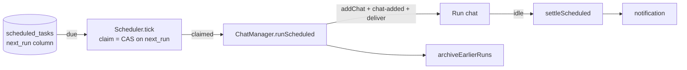

# Scheduled tasks

*Part of Carbon's design notes. The contract, the session flow and the provider
seams are in `CLAUDE.md`; the other surfaces are the neighbouring files in this
directory.*

A scheduled task is **a prompt Carbon sends on a schedule, each time in a new
chat**: "every weekday at 9, summarize the open PRs", "once tomorrow at 8,
remind me to rotate the key". It is made on the Scheduled page (sidebar →
Scheduled) or by any chat's agent through `schedule_create`, and each run is an
ordinary chat from its first event on — same sessions, same permissions, same
transcript.

### Where it lives (`shared/schedule.ts`, `main/scheduleStore.ts`)

**A schedule is cron in local time, or one moment.** Five-field cron with
names, ranges, steps, the `@daily` macros and cron's own day-of-month/
day-of-week OR rule; `nextCronRun` builds each candidate as a local date, which
is what handles daylight saving: the repeated autumn hour resolves to its first
occurrence and, once fired, is no longer *after*, so nothing runs twice; a time
inside the skipped spring hour lands just past it (02:30 runs at 03:30) instead
of being lost for the day. The page never shows cron: its presets compile to an
expression and `presetOf` reads them back, so an edit reopens the preset it was
made with. Main and the renderer import the same module, so the "next run" on
the page is the time that fires.

**Tasks are a table in `chats.db`, not `settings.json`, because of the claim.**
`userData` is shared between the dev and packaged builds and both run a
scheduler. `next_run` is a real column, and a run is owned by whichever
instance's `UPDATE … SET next_run = <following> WHERE next_run = <due>` lands —
one statement, serialized by SQLite, `changes === 1` for exactly one caller.
Without it every task fired twice whenever `npm run dev` was up beside the
installed app. The table is additive and unversioned, like `canvases`.

- **Every save decides inside the write lock** (`ScheduleStore.save`, `BEGIN
  IMMEDIATE`, reading the row there). Each read-then-write outside one lost to
  the other instance somehow: an edit resurrected a task deleted in between, or
  wrote a stale schedule beside the next-run time of the one that replaced it.
  An update never inserts. An edit that leaves *when* alone does not write
  `next_run` at all — writing back the value it had read would undo a claim
  made in the meantime and fire a one-off twice; a changed schedule writes a
  time computed from now, which no earlier claim can have taken. The scheduler fires from the row re-read *after* its
  claim, so an edit landing between the list and the claim is what runs.
- **`lastRunAt` / `lastChatId` are set with one `json_set`**, never a read,
  merge and write that would put back another instance's edit.
- **Within a day the earliest candidate wins**, not the first in field
  order: a time in a skipped stretch normalizes forward (Lord Howe's half-hour
  change turns 02:15 into 02:45) past a value that was valid all along.
- **A provider this build lacks** (a branch wrote the row) is coerced at the
  read, as chats are, and the task comes back **paused**: running it on Claude
  is not what anyone scheduled.
- **Every write marks the rolling backup due**, as a chat write does; a
  session that only touched tasks otherwise never backed them up.
- **Corruption recovery copies the table** with the chats' source precedence.
  Tasks keep no tombstones, so a row filled in from an older backup may be one
  the user deleted: it comes back **paused, with no next run**, rather than
  firing on the first tick.

### The clock (`main/scheduler.ts`)

One timer, armed for the soonest due task and capped at a minute; each tick
re-reads the table (another instance may have created, edited or fired
anything) and claims what is due.

- **Catch-up is one run, computed from now.** The claim moves `next_run` to
  `nextRun(schedule, now)`, not to the slot after the one that was due, so a
  task overdue by a night asleep or a weekend quit fires once on wake and then
  resumes its schedule. A run that starts more than two minutes late records
  `dueAt` and says so in the line it opens with.
- **The minute cap is what a timer cannot see**: timers do not advance while
  the Mac sleeps, the wall clock can move, and a task another instance made
  arrives without a word. `powerMonitor`'s `resume` and `unlock-screen` poke it
  at once, and so does every save here. The first tick waits four seconds after
  launch so overdue runs do not spawn sessions ahead of first paint.
- **It runs while the app runs, window or not.** On macOS closing the window
  leaves the process — and the scheduler — up. Nothing wakes a sleeping Mac or
  launches a quit app: that would need a LaunchAgent (and `pmset` for wake),
  which an unsigned app should not be installing behind the user's back. The
  page says so in one line.
- `tick` is guarded against re-entry: a run started from inside the loop
  reports a change that could poke straight back in.

### A run (`ChatManager.runScheduled`)

The delegate's first-round path, minus the parent: build the `ChatData`,
`addChat`, emit `chat-added`, `deliver` the prompt with a hidden brief saying
nobody pressed send and the last message is what the user will read. The chat is
titled with the task's name (`titleManual`, so no title turn is spent and forty
runs are told apart by date rather than by forty paraphrases), and an `info`
event above the prompt names the task, its schedule and whether it is a
catch-up or a hand-started run. The prompt itself is shown — a `label` would
hide the words the user wrote.

- **The stored provider/model pair goes through `providerForRememberedModel`**
  at fire time: a task row outlives the branch that wrote it the way a chat row
  does.
- **A clock-fired run is skipped while the task's previous run is still
  going.** Two copies of one job racing in one checkout is never what "every 15
  minutes" meant; "Run now" is a deliberate second one and is allowed. A
  `running` record counts only with something behind it — a session here, or,
  for a chat this instance does not own, a `running` status *in the database*
  (`storedMeta` — a resident copy can predate the owner finishing it) plus that
  instance's live lock (`scheduledRunLive`); otherwise it died with an
  instance that quit after this one's launch-time reconcile gave up, and it is
  called interrupted on the spot rather than blocking the task forever.
- **A run's record exists before anything is awaited.** A worktree can take
  seconds to check out, and the overlap guard below only sees runs: the chat
  is added `running` first (in another instance it counts through that
  persisted record and the lock `addChat` takes, here through
  `scheduledStarting`), and its `cwd` moves to the worktree once one exists.
  That makes the chat visible before it can run, so setup is a **barrier**:
  the chat shows as working, a message sent meanwhile is held and sent after
  the run's prompt (a session opened earlier would have opened in the
  checkout the task asked to stay out of), Stop cancels the run before it
  starts, and a chat deleted during setup gets no session at all. Reconcile
  skips a run in setup like one with a session. A run that never started
  (setup failed, or Stop) is marked `notStarted`: it has no worktree, so what
  was queued during setup is *not* sent into the checkout — main says held
  messages back as an event, the renderer leaves its queue alone — until the
  user's own next send clears the mark, which is the choice to work there.
- **Worktree runs get a new worktree each**, on `scheduled/<task>-<stamp>`, and
  they are kept: removing one is removing a chat's working directory, which
  `docs/worktrees.md` already gives the user tools for. A worktree that cannot be
  made fails the run visibly in its chat rather than falling back to the
  checkout the user asked it to stay out of.
- **Settling is delegation's rule**, through the same six hooks: the
  `scheduledStarted` guard (an idle before the turn shows is a session
  announcing itself), `onChatSettled` (over only when nothing of it runs),
  `deliver`'s catch (a provider that cannot construct), `interrupt`
  (`scheduledStopped` — a stopped transcript looks finished), `disposeChat`
  (busy → stopped), and `pruneIdleSessions`, which never disposes a running
  one. The outcome is read with `delegationOutcome` from the opening prompt.
  **A run that delegated is not over at the idle after `agents_delegate`**
  (`scheduledWorkOutstanding`): it waits for its delegates, their reports'
  delivery and the turn that answers them, and is read after
  `flushDeliveries`, since a delivery just taken is a turn the run is still
  in. A parked delivery does not hold it — nothing more comes on its own.
  Quitting leaves `running` on disk and `reconcileScheduled` calls it
  `interrupted` at the next launch, with the lock check and retry
  `reconcileDelegations` uses.

**One row per task in the sidebar.** When a run starts, the task's earlier runs
that are over and were never written in move to the archive
(`archiveEarlierRuns`) — an hourly task would otherwise be 168 rows a week. A run
the user answered (`touched`, set by `send`), pinned, or that is still working is
a conversation and stays. The archived ones remain the task's history on the
page, and opening one restores it (the rule `openChat` already applies to every
archived chat). A run swept while it is the chat on screen is put straight back
by the renderer's `meta` reducer instead of being closed under the reader.

**Notifications** come from main (`notifyScheduled`), not the renderer, because
the common case is no window at all: a run's ending says how it went, a run
stuck on an approval says so, and a click creates the window if needed before
opening the chat. The generic "finished responding" notice is suppressed for a
run so it is not said twice.

### The agent's tools (`main/scheduleTools.ts`)

`schedule_create`, `schedule_list`, `schedule_update`, `schedule_delete` and
`schedule_run` on the `carbon` server, one table for every provider like the
`agents_*` tools. The calling chat supplies what the model did not — provider,
model (a nickname resolved through `resolveModel`), effort, project root — and
**its permission mode is the ceiling**, as a delegate's is: a new task is
clamped to it, and a task already above it can be neither run (`schedule_run`)
nor rewritten by that agent — rewording its prompt would be new work at that
level. Deleting is allowed; it only takes capability away. Every check runs
*after* the model-catalog await, against the chat as it is then. Times are local:
`cron`, a bare `at` date-time, or `in_minutes`, exactly one; every reply ends
with the current local time and zone, since that is what "at 9" is relative
to.

- **Never from a run or a delegate** (`canSchedule`), checked at `tools/list`
  and again at every call through the host's `allowed` — a task that schedules
  a task on each run is a fan-out nobody asked for.
- **Plan mode refuses** every one but `list` (`isCarbonSideEffect`).
- `SCHEDULE_SESSION_RULES` rides each provider's rules where the tools are
  offered, so the model reaches for them before reaching for `sleep` or a system
  cron job.

### The page (`components/Scheduled.tsx`)

A page like Pull requests, because it is where runs are *found* as well as
where tasks are kept: list on the left (schedule, next run, last run's state),
detail on the right (pause switch, Run now, the prompt, every run with its
outcome). **The editor's prompt box is the composer itself**, with the model,
effort and permission pickers a chat has, and its send button (labelled through
`Composer`'s `submitLabel`) saves the task: a scheduled task *is* "this
message, on this model, later", and a form re-describing those controls would
be a second vocabulary for one thing. A new task defaults to Accept edits, since
nobody is there to answer an Ask-mode approval. The sidebar's Scheduled row
counts runs that finished unseen or are waiting on an approval.

### Not built, on purpose

Waking the Mac or launching a quit Carbon (above); the remote/phone client,
whose IPC allowlist does not include the `scheduled:*` channels; and attachments
on a scheduled prompt, which the editor refuses rather than storing file bytes
in a task row.
